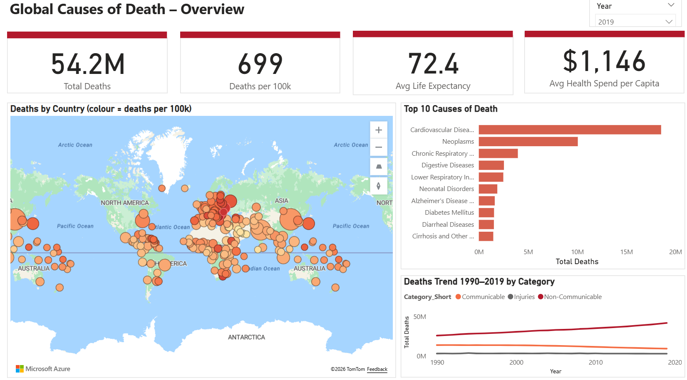
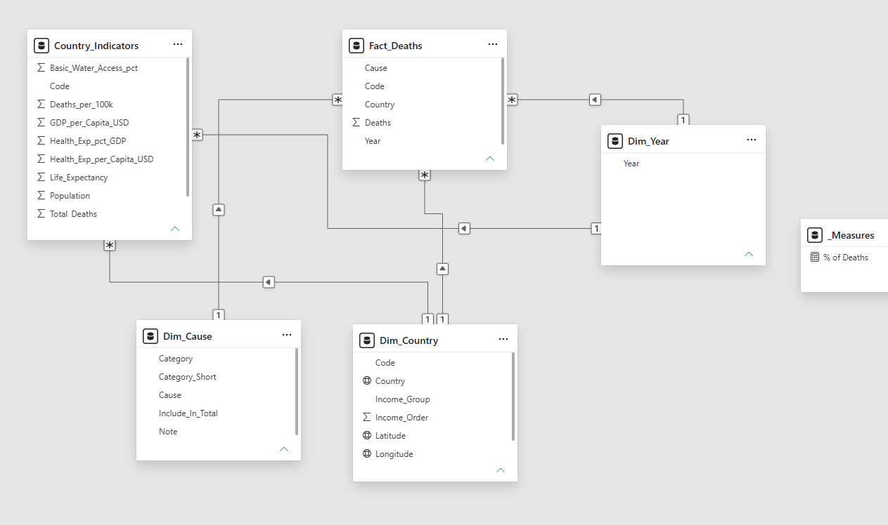
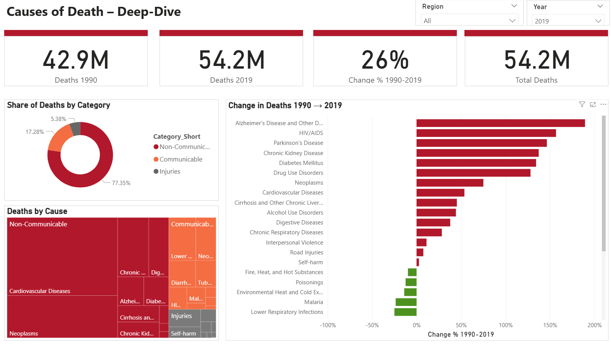
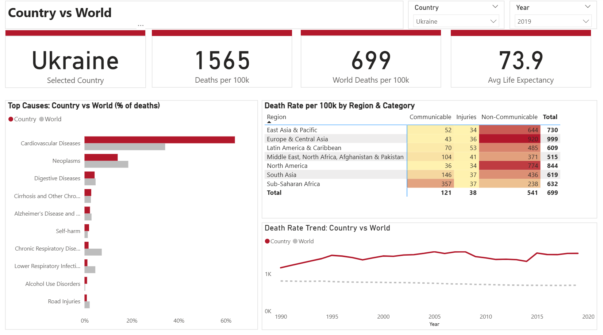
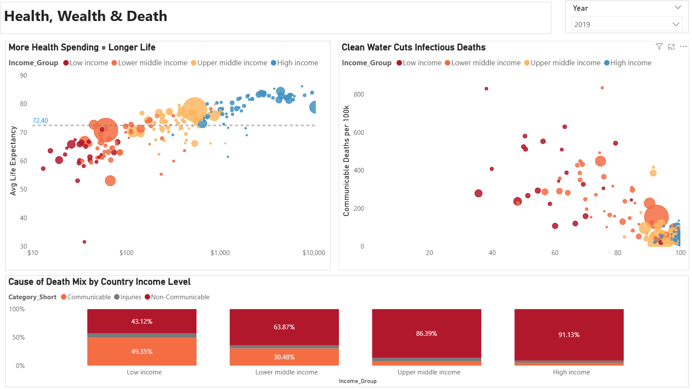

# 🌍 Global Causes of Death Dashboard (1990–2019)

An interactive **Power BI** dashboard that explores what people around the world die from, how it has changed over 30 years, and how health spending, clean water and national income relate to life expectancy and causes of death.

### 🔗 [**View the live interactive dashboard**](https://app.powerbi.com/view?r=eyJrIjoiZjgyMmQzYTItOTk3ZC00NzU1LWJkODgtNGVkZGM1M2EwZmY3IiwidCI6IjEwMWRhNTg3LTE4NDMtNGY1Mi04YjhhLTE3YjA2OWM2NmQzMyIsImMiOjJ9)



---

## 📌 Project Overview

More than 50 million people die every year, but *what* they die from depends heavily on *where* they live. This project combines global disease data with World Bank development indicators to answer four questions:

1. **How many people die, where, and from what?**
2. **Which diseases are growing or shrinking since 1990?**
3. **How does a single country compare with the world?**
4. **Do money, healthcare and clean water reduce deaths?**

---

## 📊 Data Sources

| Dataset | Source | Coverage |
|---|---|---|
| Deaths by cause | [Cause of Deaths around the World (Kaggle)](https://www.kaggle.com/datasets/iamsouravbanerjee/cause-of-deaths-around-the-world), based on the **IHME Global Burden of Disease 2019** study | 204 countries, 31 causes, 1990–2019 |
| Country indicators | **World Bank** World Development Indicators API | Population, life expectancy, GDP per capita, health spending, clean water access, region, income group |

> Health spending and clean-water data start in **2000**.

---

## 🗂️ Repository Structure

```
Global_Causes_of_Death_PowerBI_Project/
├── Global_Causes_of_Death_Dashboard.pbix   ← Power BI report
├── Data/
│   ├── Fact_Deaths.csv
│   ├── Dim_Country.csv
│   ├── Dim_Cause.csv
│   ├── Country_Indicators.csv
│   └── README.md                           ← data dictionary
├── DAX/
│   └── Measures.dax                        ← all DAX measures
├── Screenshots/                            ← images of each page
├── Presentation/
│   └── Talking_Points.md                   ← presentation script
└── README.md
```

---

## 🛠️ Tools & Skills

- **Power Query**: cleaning, unpivoting wide data into long format, conditional columns
- **Data modeling**: star schema with one fact table and dimension tables
- **DAX**: death rates, % share, year-over-year change and country-vs-world comparisons
- **Visualization**: bubble map, bar, line, donut, treemap, matrix heatmap, scatter and 100% stacked charts
- **Interactivity**: synced slicers, cross-filtering and edited visual interactions

---

## 🧩 Data Model

```
             Dim_Year
             /      \
Dim_Cause — Fact_Deaths — Dim_Country — Country_Indicators
                                  (Code)        (Code + Year)
```

| Relationship | Type |
|---|---|
| `Dim_Cause[Cause]` → `Fact_Deaths[Cause]` | 1 : * |
| `Dim_Country[Code]` → `Fact_Deaths[Code]` | 1 : * |
| `Dim_Country[Code]` → `Country_Indicators[Code]` | 1 : * |
| `Dim_Year[Year]` → `Fact_Deaths[Year]` | 1 : * |
| `Dim_Year[Year]` → `Country_Indicators[Year]` | 1 : * |



Causes are grouped into three categories: **Communicable** (infections, maternal, neonatal, nutritional), **Non-Communicable** (chronic diseases) and **Injuries**.

See [`DAX/Measures.dax`](DAX/Measures.dax) for all measures.

---

## 📄 Dashboard Pages

### 1. Overview
KPI cards, a bubble map (size = deaths, colour = deaths per 100k), the top 10 causes and a 1990–2019 trend by category.


### 2. Causes Deep-Dive
Share of deaths by category, a treemap of all causes, and the % change in deaths for each cause from 1990 to 2019, with a region filter.


*Deaths grew 26% from 1990 to 2019; Alzheimer's, HIV/AIDS, Parkinson's and kidney disease grew fastest, while malaria and lower respiratory infections fell.*

### 3. Country vs World
Pick any country to compare its death rate, top causes and 30-year trend with the world average, plus a region × category heatmap.


*Example: Ukraine has 1,565 deaths per 100k, more than double the world's 699, and heart disease causes over 60% of its deaths.*

### 4. Health & Wealth
Scatter charts of health spending vs life expectancy and clean water vs infectious deaths, and the cause-of-death mix by income level.



---

## 💡 Key Insights (2019)

- **About 54 million deaths** from the 31 causes, or **699 per 100,000 people**.
- **Heart disease is the #1 killer**, at about **18.6 million deaths (about 1 in 3)**, followed by cancer at about **10 million**.
- **77%** of deaths are from non-communicable diseases, about **17%** from communicable diseases and about **5%** from injuries.
- Total deaths grew **26%** from 1990 (42.9M) to 2019 (54.2M), driven by population growth and ageing.
- **Alzheimer's deaths grew about 190%**; Parkinson's, kidney disease and diabetes also more than doubled. Malaria, lower respiratory infections and diarrheal diseases **declined**.
- **Pakistan**: a lower death rate than the world (608 vs 699) because of its young population, but **neonatal disorders cause about 18% of deaths vs about 3% globally**.
- **Sub-Saharan Africa** has the highest infectious-disease death rate (**about 357 per 100k**, roughly 10× North America's), while **Europe & Central Asia** has the highest chronic-disease rate (**about 920 per 100k**).
- Higher **health spending** is strongly associated with **longer life expectancy**, and low **clean-water access** with high infectious-disease deaths.
- In **low-income** countries about **49%** of deaths are from infections; in **high-income** countries **91%** are from chronic diseases.

> **The big story:** the world is shifting from dying of infections to dying of chronic diseases, but many deaths in poorer countries are still preventable.

---

## ⚠️ Limitations

- The data ends in **2019**, so it doesn't include COVID-19.
- It covers **31 major causes**, not every cause of death.
- Death rates are **crude (not age-adjusted)**, so countries with older populations look worse. Life expectancy and % of deaths are used alongside them.
- Figures are **model-based estimates** from IHME.
- **Correlation is not causation**: richer countries differ in many ways beyond health spending.
- Taiwan, Cook Islands, Niue and Tokelau have no World Bank indicator data.
- *Protein-Energy Malnutrition* is a subset of *Nutritional Deficiencies* and is excluded from totals to avoid double counting.

---

## ▶️ How to Use

**Online (no install):** open the [live dashboard](https://app.powerbi.com/view?r=eyJrIjoiZjgyMmQzYTItOTk3ZC00NzU1LWJkODgtNGVkZGM1M2EwZmY3IiwidCI6IjEwMWRhNTg3LTE4NDMtNGY1Mi04YjhhLTE3YjA2OWM2NmQzMyIsImMiOjJ9) and use the page list or arrows at the bottom.

**In Power BI Desktop:**

1. Install [Power BI Desktop](https://powerbi.microsoft.com/desktop/) (free, Windows).
2. Download or clone this repository.
3. Open `Global_Causes_of_Death_Dashboard.pbix`.
4. If prompted, go to **Transform data → Data source settings** and point the sources to the CSV files in the `Data/` folder.
5. Use the **Year**, **Region** and **Country** slicers, and click on visuals to cross-filter.

---

## 👤 Author

**Naseer**, Data Analyst
Data Analysis | Storytelling | Power BI | Tableau | SQL | Python | Excel

- LinkedIn: [your-linkedin-url]
- Email: [your-email]

---

## 🙏 Acknowledgements

- Data from the **Institute for Health Metrics and Evaluation (IHME)**, the Global Burden of Disease Study 2019, and the **World Bank**.
- Thanks to **Nashville Software School** and my instructors for their guidance.

*This project is for educational and portfolio purposes. Data belongs to the original sources and is subject to their terms of use.*
